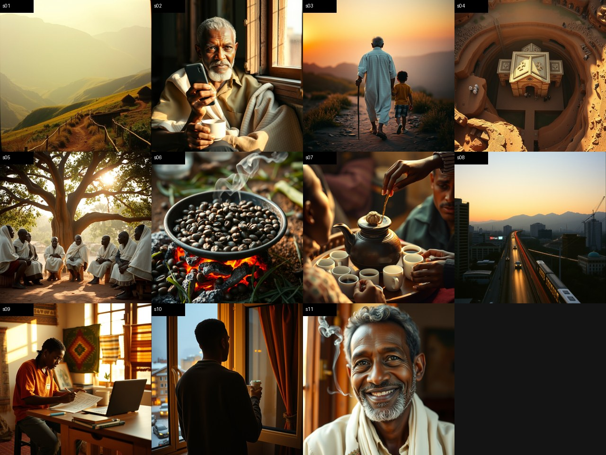
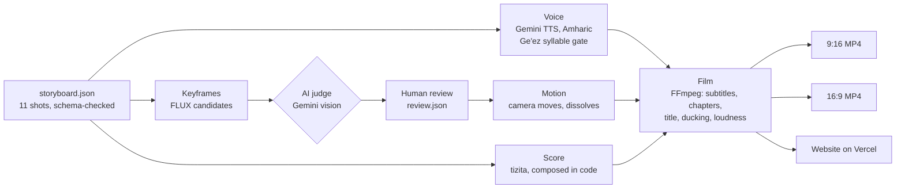

# The Roots We Carry · ሥርህን ይዘህ ትሄዳለህ

[](https://github.com/gecher/heritage-short/actions/workflows/tests.yml)
-brightgreen)
-orange)

A 90-second Amharic film about Ethiopian heritage, rebuilt from one file (`storyboard.json`) with one command.

A father in Addis Ababa answers his son abroad, who asked what Ethiopia is, by showing him what his own father once showed him: the highlands, a church carved from rock, the elders under the warka tree, the coffee ceremony, and the new generation.

| | Link |
|---|---|
| 🎬 Film, vertical 9:16 (phones) | https://the-roots-we-carry.vercel.app/films/the_roots_we_carry_9x16.mp4 |
| 🎬 Film, horizontal 16:9 (laptops, YouTube) | https://the-roots-we-carry.vercel.app/films/the_roots_we_carry_16x9.mp4 |
| 🌐 Website | https://the-roots-we-carry.vercel.app |
| 🎥 Walkthrough (≤ 5 min) | https://the-roots-we-carry.vercel.app/films/the_roots_we_carry_walkthrough.mp4 |
| 📣 Public post | https://x.com/getacher90th/status/2125995579901722791 |
| 📄 Report (PDF) | [docs/The_Roots_We_Carry_Report.pdf](docs/The_Roots_We_Carry_Report.pdf) |



## What is special about it
- **Amharic voice with a Ge'ez quality gate.** Each line is checked against its syllable count (each fidel ≈ one syllable). Takes that are too long, for example when the model read the English instruction aloud, are rejected and re-recorded automatically.
- **An AI judge, and an Ethiopian eye over it.** Every shot has several image candidates scored for prompt match, character consistency, Ethiopian appearance and cultural accuracy. Where the judge accepted something an Ethiopian viewer would reject, the human review overruled it (`review.json`).
- **A tizita score composed in code.** No music model had free quota, so `pipeline/score.py` writes an original score in the tizita scale, timed to the film's cues.
- **Bilingual on screen.** Amharic in Ge'ez script above English subtitles, chapter marks in Ge'ez numerals (፩ ፪ ፫ ፬ ፭), the title written fidel by fidel, a tibeb border.
- **Two films from one command:** 9:16 for phones and 16:9 for laptops and YouTube, both built from the same cached shots.
- **A website** (`web/`, static, no keys): the film in either shape with Ge'ez chapter buttons, the story, how it was made, and the score played instrument by instrument. Built by `python -m pipeline site` and hosted on Vercel.
- **Honest engineering.** Content-hash caching, fallback chains, a call log, 18 documented failures, 11 experiments.

## How it works

Every box caches its output under a hash of all its inputs and logs every call to `runs.jsonl`, so a re-run with nothing changed makes no API calls, and changing one shot rebuilds only that shot. Details: [ARCHITECTURE.md](ARCHITECTURE.md).

## Quick start
```bash
git clone https://github.com/gecher/heritage-short && cd heritage-short
python -m pip install -r requirements.txt
cp .env.example .env          # add your own keys (never commit .env)
python -m pipeline smoke      # one call per provider, logged to runs.jsonl
python -m pipeline film       # the whole film, twice: outputs/film/the_roots_we_carry_9x16.mp4 (phones) and _16x9.mp4 (laptops, YouTube)
python -m pipeline site       # the website's data and assets -> web/
python -m pipeline report     # COSTS.md from runs.jsonl
```
Needs Python 3.11+, FFmpeg (set `FFMPEG_BIN` in `.env` if it is not on PATH), a Gemini API key and a Cloudflare Workers AI token. On Windows the Amharic text uses the Ebrima font; elsewhere set `FONT_FILE` to a font with Ethiopic letters.

## All commands
| Command | What it does |
|---|---|
| `validate` | check `storyboard.json` against the schema and the film rules |
| `narration` | Amharic narration, one cached file per shot |
| `say "..."` | speak one test phrase (pronunciation trials) |
| `radio` | audio-only cut on black, to test the story before any picture |
| `reference` | candidate portraits of the father; pick one into the storyboard |
| `keyframes` | image candidates per shot, judged, best one chosen, contact sheet |
| `music` | the score: Lyria if available, otherwise composed in code |
| `film` | everything in order, then the final MP4s: 9:16 and 16:9 (`film 16x9` for one) |
| `site` | the website in `web/` |
| `report` | COSTS.md: every call, and measurements of the outputs (pace, judge, loudness) |

## Tests
```bash
python -m pytest -q      # 13 fast checks, also run by GitHub Actions on every push, no API calls: the contract, the cache, the Ge'ez gate, timing, transitions, formats
```

## Website
`web/films/` holds the two full-quality 1080p films, copied there for submission and direct links. `web/` is a plain static page: `index.html` plus `data.js` and `assets/` written by `python -m pipeline site`. Open `web/index.html` directly, or serve it (`npx serve web`; Python's `http.server` cannot seek inside videos). Vercel serves it with the project's Root Directory set to `web`.

## Repository layout
```
storyboard.json          the film, as data: 11 shots, voice, music, style
schema/                  the contract the storyboard must satisfy
pipeline/                one module per stage (python -m pipeline <command>)
  common.py              validation, cache keys, retries, call log
  narration.py           Amharic TTS + Ge'ez syllable gate
  keyframes.py           FLUX candidates, Gemini judge, contact sheet
  shots.py · film.py     camera moves, transitions, final assembly (9:16, 16:9)
  score.py · music.py    the tizita score
  site.py · report.py    the website data, COSTS.md
tests/                   13 fast checks (no API calls), run on every push
review.json              the human review that overruled the AI judge
runs.jsonl               every model call: time, model, latency, status, error
outputs/                 cached narration, keyframes, score (films are linked above)
web/                     the static website deployed on Vercel
docs/                    the PDF report
```

## My contributions and how AI was used
I (Getacher Ashebir Yimer) directed and built this project; I used Claude as a coding assistant, and generative models for the media. To be clear about who did what:

| Area | My part | AI's part |
|---|---|---|
| Story and audience | Chose the father's-letter story from three options; defined audience and intent ([DESIGN.md](DESIGN.md)) | Suggested story options |
| Amharic | Wrote and reviewed every narration line as a native speaker; caught the mispronounced "ኢትዮጵያ" and chose the re-recorded take | Gemini TTS spoke the lines |
| Cultural review | Rejected frames the AI judge accepted (a father who looked South Asian, a European-style church, Middle-Eastern head cloths, wrong coffee setup) and set the rewritten prompts' intent ([review.json](review.json)) | FLUX drew the images; Gemini judged them |
| Pipeline code | Set the requirements (one storyboard, one command, caching, bilingual subtitles, two formats, transitions, website), ran every stage on my machine, reviewed results and asked for fixes | Claude drafted most of the code and documents under my direction |
| Decisions | Chose free-only tools (no paid image quota), the reference portrait of Abba, the Vercel website design, posting on X | — |
| Walkthrough and post | Recorded the walkthrough narration in my own voice; published the post | Assembled the walkthrough screens |

Every failure and experiment I went through is recorded with evidence in [FAILURES.md](FAILURES.md) and [EXPERIMENTS.md](EXPERIMENTS.md).

## Documents
- [DESIGN.md](DESIGN.md): audience, intent, story, user tests
- [ARCHITECTURE.md](ARCHITECTURE.md): stages, the contract, caching, failure handling
- [FAILURES.md](FAILURES.md): what broke and how it was fixed
- [EXPERIMENTS.md](EXPERIMENTS.md): one change at a time, with evidence
- [COSTS.md](COSTS.md): every call, measured ($0: free tiers)
- [ETHICS.md](ETHICS.md): consent, licences, labelling, cultural care
- [review.json](review.json): the human review of the AI judge

## Known limits and next steps
- Shots s03, s07 and s10 still have cultural weaknesses; better prompts are written (FAILURES F15) for when the free image quota resets.
- Image-to-video motion (Wan on a Kaggle GPU) for one or two hero shots; any clip placed at `outputs/shots/<id>-i2v.mp4` replaces the camera move.
- "Write your own letter home" on the website: a visitor types a message and hears it in Amharic (needs a small server for the API key).
- The three rounds of the coffee ceremony (abol, tona, bereka) as the structure of a second film.

*Made with AI (FLUX.1 schnell, Gemini TTS, Gemini flash-lite). All characters are fictional. Amharic written and checked by a native speaker.*
